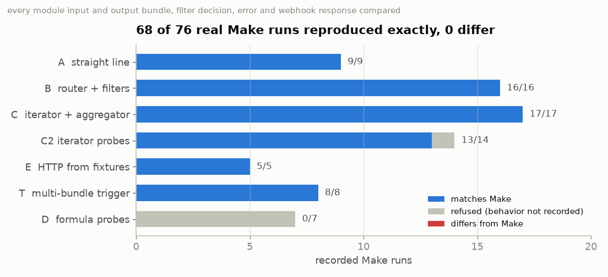
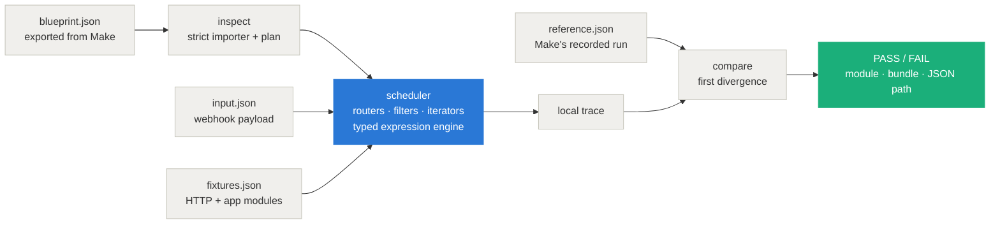

<div align="center">


# blueprint-runtime — run and test Make scenarios offline

**Replay real Make runs on your own machine and see the first value that changed: no Make account, no credits, no network. Every behavior it claims was recorded in a real Make run; anything else is refused, never guessed.**

[](LICENSE)
[](https://nodejs.org/)
[](corpus/NOTES.md)
[](test/)
[](package.json)

[Demo](#demo) · [Results](#results) · [Quick start](#quick-start) · [How it works](#how-it-works) · [Supported](#what-runs-today) · [Fixtures](#fixtures-http-and-third-party-modules) · [Limitations](#limitations)

</div>

---

## What this is

You build a scenario in Make, it works, and then someone edits a mapping. The only way to know what broke is to run it again in Make, with real data and real credits.

`bpr` runs the blueprint locally instead. It replays inputs that went through the real scenario and compares every module's input and output bundles, every filter decision, the outcome and the webhook response with what Make actually produced, then points at the first difference:

```
$ bpr test examples/broken-mapping
FAIL  A-002-plain   module 2 input bundle 1 at /value: Make had "ADA LOVELACE", the local run "Ada Lovelace"
```

Someone changed `upper(1.name)` to `capitalize(1.name)`. See [examples/broken-mapping](examples/broken-mapping/).

**The rule.** Every behavior this runtime supports was observed in a real Make run, and the recordings are in [`corpus/`](corpus/NOTES.md). If a blueprint uses something that has not been observed (a module, an operator, a function, a setting), `bpr` says what and refuses. That is why some of Make's quirks are reproduced exactly: a field of a plain-text iterator bundle reads as the text itself, and arrays written as text use a comma plus a NO-BREAK SPACE. It is also why the one quirk that could not be explained is refused instead of copied: for the bundle `0`, Make returned the previous bundle's value.

## Demo


Generated from real command output by [`docs/make_demo.py`](docs/make_demo.py).

## Results



76 runs were recorded in a free Make account across seven scenario families. 68 are reproduced exactly and **none differ**. The 8 that are refused, not failed:

- **D (7):** the formula-probe blueprint contains `replace(s; /o/g; "0")`. Make ignored that regex in a real run for a reason nobody has recorded, so `bpr` refuses the file. The engine still matches 530 of 535 recorded formula results from these runs, plus 66 of 67 from the D2 probe set.
- **C2 (1):** the bundle `0` read the previous bundle's value in Make. That is refused rather than modeled.

![25 of 221 public blueprints run today: 25 eligible, 175 not yet supported, 21 invalid exports. Most common blockers: [] array mapping 61, now keyword 52, json:ParseJSON 32, error-handler routes 31, util:SetVariables 25, HTTP states-as-errors off 24, other modules per iterator bundle 23, array aggregator 20.](docs/charts/2_survey.png)

**How much of the real world runs today: 25 of 221 public Make blueprints on GitHub (11%), all with fixtures.** Most are small. Polling and app triggers (Google Sheets, RSS, Typeform, …) were the biggest blocker (83 files) until v0.2. The chart on the right is the roadmap. Method, full table and per-file results: [`corpus/survey/`](corpus/survey/README.md).

## Quick start

Requires Node 24 or newer (it runs the TypeScript source directly).

```
git clone https://github.com/intikhab49/blueprint-runtime
cd blueprint-runtime
npm ci
npm run build && npm link        # puts `bpr` on your PATH (or use `node src/cli.ts` everywhere below)

bpr test corpus/reference --allow-unsupported      # replay all 76 recorded Make runs
bpr test examples/broken-mapping                   # a broken mapping, caught
bpr inspect corpus/blueprints/B.blueprint.json     # what a blueprint uses, and whether it can run
```

No Make account is needed for any of this. The recorded runs are in the repository.

## How it works



- **Importer.** It is strict on purpose: duplicate JSON keys (which `JSON.parse` silently drops), oversized or too-deep files, duplicate module ids, broken routes and bad fallback indexes are reported with line and column. It also computes a semantic hash: moving modules on the canvas keeps it, while changing a mapping, filter, route or setting changes it.
- **Expression engine.** It has its own tokenizer, parser and typed evaluator for Make's formula language, and never uses `eval` (a test scans the source to prove it). `missing` and `null` stay apart, dates are real instants in the scenario's timezone, and `+ - *` use exact decimal arithmetic the way Make does. It covers 58 functions, each replayed against Make's own output.
- **Scheduler.** Routes run in order and every passing route runs, with the fallback only when none did. Filters short-circuit like Make. Iterators process bundles depth-first and the Text aggregator collects them, with operations counted the way Make counts them.
- **Comparison.** It goes module by module: input bundles, output bundles, filter decisions with their per-condition report, the outcome (success or Make's exact error) and the webhook response. Key order is ignored; `missing` vs `null` and numbers vs text are not.

## `bpr test`

```
bpr test <case.json | folder>... [--json] [--allow-unsupported]
```

A case names a blueprint, an input, optional fixtures and the run Make actually produced. The input is the webhook payload, or, for a third-party app trigger such as Google Sheets "Watch rows", the list of bundles the trigger emitted (the connector itself is not verified; how a run processes several bundles was recorded with Make's Basic trigger, corpus T):

```json
{ "schemaVersion": 1, "name": "A-002-plain", "blueprint": "../../blueprints/A.blueprint.json",
  "input": "./input.json", "environment": { "timezone": "Asia/Karachi" }, "expected": "./reference.json" }
```

Exit codes: `0` all matched · `1` a case differs · `2` invalid case · `3` something without recorded Make behavior (`--allow-unsupported` lets those pass) · `5` a fixture is missing, wrong or unused · `6` local limit.

`bpr run <blueprint.json> --input <payload.json> [--fixtures <fixtures.json>] [--timezone <IANA>]` prints the local trace.

## `bpr inspect`

```
bpr inspect <blueprint.json>... [--json]
```

It lists every module, where it sits (main flow, route, fallback, error handler), every `{{…}}` expression with its references and functions, the fixtures the blueprint needs, and everything without recorded Make behavior, each with its reason. A file it calls eligible also runs without a refusal: the survey checked all 18 against the scheduler. Exit codes: `0` eligible · `2` invalid file · `3` uses something unsupported.

## What runs today

| | Supported (recorded in Make) | Not yet (refused with the reason) |
|---|---|---|
| **Triggers** | Custom webhook; Basic trigger; any third-party app trigger (Google Sheets, RSS, Typeform, …) with its bundles as the case input; several bundles per run, each through the whole flow | mail hooks, scenarios that start with an action (HTTP, Set variable), an aggregator on a trigger that emitted nothing |
| **Flow** | routers (every passing route, fallback route), filters with 31 operators and Make's short-circuiting, iterators with or without a Text aggregator (`\n`, `\t` or custom separator) | error-handler routes, array aggregator, repeaters, routers or responses running once per iterator bundle, multi-cycle runs |
| **Modules** | Set variable, Webhook response, HTTP "Make a request" v3 (from fixtures: 200, 201, 404 recorded), any third-party app module from a fixture | `json:ParseJSON`, `util:SetVariables`, Sleep, Ignore, the newer `http:MakeRequest`, code modules, data stores |
| **Expressions** | 58 functions, operators with Make's precedence and decimal arithmetic, 1-based indexes, Make's text conversion of arrays and objects | `[]` array mapping, the `now` keyword, `var.*` custom variables, regex literals, single-quoted text |
| **HTTP** | request built from the mapping and checked against the fixture, response shaped exactly as Make does | other statuses, custom request headers, auth, query-string fields, "Evaluate all states as errors" off |

Full detail and evidence for every row: [`corpus/NOTES.md`](corpus/NOTES.md).

## Fixtures (HTTP and third-party modules)

A case can add `"fixtures": "./fixtures.json"`. There are two modes:

| Mode | For | Checked | Proves |
|---|---|---|---|
| `http` | `http:ActionSendData` v3 | the request the module builds (method, URL, content type, body) must equal the fixture's | request construction and everything downstream; the response becomes the output bundle exactly as Make shapes it (`statusCode`, `headers`, `cookieHeaders`, `data`, `fileSize`) |
| `module` | third-party app modules (e.g. `google-sheets:addRow`) | the mapped input bundle must equal the fixture's | downstream logic only; the connector itself is not verified |

```json
{ "schemaVersion": 1, "fixtures": [
  { "module": 2, "occurrence": 1, "mode": "http",
    "request":  { "method": "POST", "url": "https://api.example.test/x", "contentType": "application/json", "body": "{\"q\":\"a\"}" },
    "response": { "status": 200, "headers": [["content-type", "application/json"]], "body": "{\"answer\":42}" } } ] }
```

`occurrence` is the module's invocation number, because an iterator makes a module run several times. Fixtures fail closed: no fixture, a different request or input, a fixture of the wrong mode, two fixtures for one invocation, or a fixture never used all stop the case with exit `5`. There is no network fallback. Modules that run inside Make (`json`, `regexp`, `util`, …) can never be replaced by a fixture. See [examples/http-fixture](examples/http-fixture/).

## How the evidence was collected

Everything in [`corpus/`](corpus/NOTES.md) comes from a free Make account. Scenarios were imported over the API, run with chosen payloads, and every module's input and output bundles were pulled from Make's own run log. HTTP probes called another scenario of the same account, so nothing left Make. The capture tools are in [`tools/`](tools/); they need your own Make API token (`.make-token`) and webhook URLs (`.make-hooks.json`), and both files are gitignored. Each recorded run became a test case in [`corpus/reference/`](corpus/reference/).

## Limitations

- **It covers a narrow slice of Make.** That slice is reproduced exactly, but most real blueprints use something outside it (see the survey). Every refusal names its reason, and the blockers chart is the order things should be added in.
- **A fixture proves your scenario's handling of a response, not the service.** A third-party connector is never verified.
- **Recorded on one account, one region (eu1), one timezone (UTC+5)**, during October 2026. Make can change its behavior; rerunning the capture tools would show it.
- **There are inferred details**, each marked in the code and NOTES. For example, `cookieHeaders` is `[]` for a response without cookies, because every recorded response had one.

## Develop

```
npm ci
npm run typecheck
npm test                         # 425 tests, including every recorded Make run
npm run build
python docs/make_charts.py && python docs/make_header.py && python docs/make_demo.py   # README images
```

Works with Make blueprints. Not affiliated with or endorsed by Make or Celonis. MIT licensed; the example blueprints in `corpus/public/make-skills/` are Make's own, under their MIT license.
